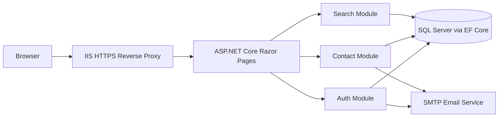

# Technical Design Document: Acme Home Services Website

| Field | Value |
|-------|-------|
| Document ID | DES-ACME-WEB-001 |
| Based on | REQ-ACME-WEB-001 (Acme Home Services Website) |
| Status | Ready for QA review |
| Author | Development Team |
| Audience | Developers, QA, Product Owner |

---

## 1. Purpose and Scope

This document describes how the development team will build the Acme Home Services public website as specified in REQ-ACME-WEB-001. It covers architecture, data model, page and endpoint design, validation rules, security controls, logging, and requirement traceability.

**In scope:** global navigation, registration, login/logout, password reset, contact form, site search.
**Out of scope:** payments/booking, admin portal, social login, native apps, multi-language (same as the requirements).

---

## 2. Technology Approach

The team has chosen a deliberately simple .NET stack: one server-rendered application and one SQL Server database. No separate frontend application, microservices, or external search service is needed.

| Concern | Decision |
|---------|----------|
| Language and framework | C# on .NET 10 LTS with ASP.NET Core Razor Pages |
| Application style | Server-rendered Razor HTML pages, CSS, and small amounts of plain JavaScript for form UX |
| Data access and database | Entity Framework Core 10 with `Microsoft.EntityFrameworkCore.SqlServer`; one Microsoft SQL Server database (SQL Server Express is sufficient for local development) |
| Email | MailKit connects to the existing SMTP email service (requirements assumption A-1) |
| Session management | ASP.NET Core cookie authentication with a server-side authentication ticket store (`ITicketStore`), held in memory for the single application instance |
| Hosting | One ASP.NET Core application on Windows Server behind IIS, which terminates HTTPS and forwards requests to Kestrel |
| Password hashing | ASP.NET Core Identity's `PasswordHasher<User>` (salted PBKDF2); no custom hashing algorithm |
| Background processing | ASP.NET Core `BackgroundService` in the same application for email retries |
| Environments | Dev, Test (QA), Production |

The existing Auth Module owns the account flows and uses the built-in password hasher and cookie authentication; the full ASP.NET Core Identity database schema is not needed. Settings come from ASP.NET Core configuration, with secrets supplied through .NET User Secrets locally and protected deployment settings outside source control.

---

## 3. Architecture

### 3.1 Logical Components

| Component | Responsibility |
|-----------|----------------|
| Web Application | Razor Pages routing and handlers, shared Razor layout, antiforgery validation, and cookie authentication |
| Auth Module | C# service for registration, login, logout, lockout, password reset, and session lifecycle; uses `PasswordHasher<User>` and EF Core |
| Contact Module | C# service for contact validation and EF Core persistence; email retries run in a hosted `BackgroundService` |
| Search Module | EF Core queries against public page content, matching, and pagination |
| Email Service Adapter | Wraps MailKit SMTP delivery; sends confirmation, reset, and inquiry emails |

### 3.2 Request Flow (Registration Example)

1. Browser submits the registration form over HTTPS.
2. The Web Application validates the CSRF token and the form fields.
3. The Auth Module checks email uniqueness, hashes the password with `PasswordHasher<User>`, and saves the user through EF Core.
4. A confirmation email is sent through the Email Service Adapter.
5. ASP.NET Core signs the user in, stores the authentication ticket server-side, sets a secure session cookie, and redirects to the Home page.

---

## 4. Pages and Routes

| Route | Method | Auth required | Description |
|-------|--------|---------------|-------------|
| `/` | GET | No | Home page |
| `/services` | GET | No | Services page (static content supplied by the business) |
| `/contact` | GET / POST | No | Contact form and submission |
| `/register` | GET / POST | No | Registration form and submission |
| `/login` | GET / POST | No | Login form and submission |
| `/logout` | POST | Yes | Ends the session |
| `/forgot-password` | GET / POST | No | Request a reset link |
| `/reset-password?token=...` | GET / POST | No (token) | Set a new password |
| `/search?q=...&page=n` | GET | No | Search results |

Routes are implemented as Razor Pages with GET and POST page handlers; a separate REST API is not needed. A shared Razor layout supplies the header and footer.

### 4.1 Shared Layout (FR-001 to FR-004)

- **Header:** logo (links to `/`), Home, Services, Contact, and a search box.
- **Signed out:** Log In and Register links are displayed.
- **Signed in:** "Hello, *first name*" and a Log Out button replace Log In and Register. The first name is truncated with an ellipsis in the header after 20 characters for layout reasons.
- **Footer:** business phone, email, and the current year (calculated at render time).

---

## 5. Data Model

The following tables map to C# entity classes through an EF Core `DbContext`. Types below are SQL Server types: `int` identifiers map to C# `int`, `bit` to `bool`, and `datetime2` to `DateTime` stored and handled as UTC. `nvarchar` columns retain Unicode text. EF Core migrations manage the schema.

### 5.1 `users`

| Column | Type | Notes |
|--------|------|-------|
| id | int IDENTITY | Primary key |
| first_name | nvarchar(50) | Required |
| last_name | nvarchar(50) | Required |
| email | nvarchar(254) | Required, stored lowercase, unique index |
| password_hash | nvarchar(256) | Encoded hash from `PasswordHasher<User>`, including salt and algorithm parameters |
| failed_login_count | int | Default 0 |
| locked_until | datetime2, nullable | UTC; set when the account is locked |
| created_at | datetime2 | UTC |

### 5.2 `password_reset_tokens`

| Column | Type | Notes |
|--------|------|-------|
| id | int IDENTITY | Primary key |
| user_id | int | FK to users.id |
| token_hash | char(64) | Hex-encoded SHA-256 hash of the token (the raw token is only in the email) |
| expires_at | datetime2 | UTC |
| used_at | datetime2, nullable | UTC; set when consumed |

### 5.3 `contact_messages`

| Column | Type | Notes |
|--------|------|-------|
| id | int IDENTITY | Primary key |
| name | nvarchar(100) | Required |
| email | nvarchar(254) | Required |
| phone | nvarchar(20), nullable | Optional |
| subject | nvarchar(30) | One of the three allowed values |
| message | nvarchar(1000) | Required |
| status | varchar(10) | `PENDING`, `SENT`, or `FAILED` |
| retry_count | int | Default 0; number of retries attempted |
| next_attempt_at | datetime2, nullable | UTC; next scheduled email attempt |
| created_at | datetime2 | UTC |

### 5.4 `site_pages`

| Column | Type | Notes |
|--------|------|-------|
| id | int IDENTITY | Primary key |
| url | nvarchar(200) | |
| title | nvarchar(200) | |
| body_text | nvarchar(max) | Plain-text version of page content |
| is_public | bit | Only public pages are searchable |

---

## 6. Feature Design

### 6.1 Registration (FR-010 to FR-016)

**Fields:** First Name, Last Name, Email, Password, Confirm Password.

| Field | Rules |
|-------|-------|
| First / Last Name | Required, trimmed, 1 to 50 characters. Unicode letters, spaces, hyphens, and apostrophes are allowed (for example "José", "O'Brien"). |
| Email | Required, trimmed, must match a standard email pattern, max 254 characters. Compared case-insensitively for uniqueness. |
| Password | Required, 8 to 128 characters, at least one uppercase, one lowercase, one digit, and one special character. |
| Confirm Password | Must exactly match Password. |

**Behavior**
- Validation runs on the client (for quick feedback) and again on the server (authoritative).
- Razor Page input models use Data Annotations and `ModelState` for validation; custom rules cover the documented name and password policies. The unique database index on email also prevents duplicates from concurrent requests.
- Errors are displayed next to each field. Entered values are re-populated except for the password fields.
- If the email already exists, the form shows "An account with this email already exists." and no row is created.
- On success: user row is created, a confirmation email containing the first name is sent, the session is created, and the user is redirected to `/`.
- Email verification is **not required** before sign-in in (assumed; see Section 11, D-2).

### 6.2 Login and Logout (FR-020 to FR-026)

**Login flow**
1. Look up the user by lowercase email.
2. If the account is currently locked (`locked_until` is in the future), return the lockout message without checking the password.
3. Verify the password with `PasswordHasher<User>.VerifyHashedPassword`; update the stored hash if the result requests rehashing.
4. On success: reset `failed_login_count` to 0, create a new session, redirect to `/`.
5. On failure: increment `failed_login_count`. When `failed_login_count` exceeds 5, set `locked_until` to now + 15 minutes. Return "Email or password is incorrect."

**Rules**
- Unknown email and wrong password both return the same generic message.
- The failed-attempt counter is reset to 0 on any successful login and when a lockout expires (resolves requirements Q-3).
- A locked account shows: "Your account is temporarily locked. Please try again later."
- **Session timeout:** the server-side ticket store checks and refreshes the last-activity time on authenticated requests, enforcing a 30-minute inactivity timeout (resolves Q-1). An expired session redirects the user to `/login`. The authentication ticket lifetime slides with this activity window.
- **Logout:** `POST /logout` calls ASP.NET Core `SignOutAsync`, removes the server-side authentication ticket, clears the cookie, and redirects to `/`.
- The password field is `type="password"`. A "Show password" checkbox toggles it to `type="text"` on the client.
- The session identifier is regenerated at login to prevent session fixation.
- The in-memory ticket store is suitable for the single-instance design: an application restart signs users out. ASP.NET Core session state is not used as a substitute for authentication.

### 6.3 Password Reset (FR-030 to FR-033)

1. User submits their email on `/forgot-password`.
2. The page always responds: "If an account exists, a reset link has been sent."
3. If the account exists, `RandomNumberGenerator.GetBytes(32)` generates a token, `SHA256.HashData` produces its stored hash, and MailKit sends an email with a URL-safe encoded token in the link.
4. Reset links expire after **24 hours** to give users time to act on the email.
5. The token is single-use. On a successful reset, `used_at` is set, and any other outstanding tokens for the user are invalidated.
6. The new password is validated with the same rules as registration.
7. An expired or used token shows "This link is no longer valid" and offers a link back to `/forgot-password`.

### 6.4 Contact Form (FR-040 to FR-045)

| Field | Rules |
|-------|-------|
| Name | Required, 1 to 100 characters |
| Email | Required, valid email format |
| Phone | Optional. When provided, must be a US 10-digit number; spaces, dashes, dots, and parentheses are accepted (international formats are TBD; see D-5). |
| Subject | Required, dropdown: General Question, Request a Quote, Report a Problem |
| Message | Required. The HTML `maxlength="1000"` attribute prevents typing or pasting beyond 1,000 characters. |

**Behavior**
- On submit, the message is saved with status `PENDING`, and a confirmation message is shown immediately ("Thank you, we will respond within 2 business days").
- An ASP.NET Core `BackgroundService` reads pending messages from SQL Server, sends the inquiry through MailKit, and updates the status to `SENT`. If sending fails, it retries 3 times (5 minutes apart) and then marks the row `FAILED` and raises an alert to the operations team (resolves Q-8). Persisted retry counts and next-attempt times let pending work resume after restarts.
- **Bot protection:** a hidden honeypot field plus ASP.NET Core rate-limiting middleware configured for 5 submissions per hour per IP address. Use the client IP forwarded by the trusted IIS proxy, not an arbitrary incoming header. A CAPTCHA is not included in (resolves Q-7 for now).

### 6.5 Site Search (FR-050 to FR-055)

- The search box submits a GET request to `/search?q=<term>&page=<n>` on Enter or on clicking the search icon.
- The Search Module uses EF Core to query `site_pages` where `is_public = 1` and the title or body contains the term (`string.Contains`, translated to SQL by the provider). Title matches are ranked above body matches. Configure an explicit case-insensitive SQL Server database collation, such as `Latin1_General_100_CI_AS_SC`, rather than relying on the server default.
- Results are returned 10 per page using EF Core `Skip` / `Take`, ordered by title-match priority and then page id for stable pagination, with Previous / Next and page-number links.
- Each result shows the title, a 160-character excerpt around the match, and a link.
- With no matches: "No results found. Need help? Contact us." where "Contact us" links to `/contact`.
- Only public pages are indexed. Signed-in-only pages do not exist in (resolves Q-5).
- EF Core **parameterizes** the search term, and Razor HTML-encodes it when echoed back on the results page; do not render user input with `Html.Raw`.
- An empty search term redirects back to the previous page with no results shown.

---

## 7. Non-Functional Design

| Req ID | Design approach |
|--------|-----------------|
| NFR-001 Performance | IIS caches and compresses static assets. SQL Server has a unique index on `users.email`. EF Core search queries use `AsNoTracking` and database-side pagination over a modest content set. Target: under 3 seconds at 50 concurrent users (assumed definition of "normal load"; see D-3). |
| NFR-002 Compatibility | Standard HTML5, CSS3, and ES2017 JavaScript. Verified on the latest two versions of Chrome, Edge, Firefox, and Safari. |
| NFR-003 Responsive design | Mobile-first CSS with breakpoints at 600 px and 1024 px. The header menu collapses into a menu button below 600 px. |
| NFR-004 Accessibility | Semantic HTML, `<label>` elements on all fields, visible focus styles, ARIA live region for validation errors, color contrast of at least 4.5:1. Target: WCAG 2.1 AA. |
| NFR-005 Security (transport and storage) | IIS terminates HTTPS; ASP.NET Core uses trusted forwarded headers, HTTPS redirection, and HSTS. Passwords use the salted PBKDF2 implementation in `PasswordHasher<User>`. |
| NFR-006 Security (vulnerabilities) | EF Core parameterized queries, Razor output encoding, ASP.NET Core antiforgery tokens on every POST form, authentication cookies set `HttpOnly`, `Secure`, and `SameSite=Lax`, and a Content Security Policy header. Persist ASP.NET Core Data Protection keys outside the deployment directory with access restricted to the application identity. |
| NFR-007 Privacy | Passwords, tokens, and message bodies are never logged. See Section 8 for what is logged. |
| NFR-008 Reliability | Single IIS-hosted application instance with an ASP.NET Core health-check endpoint and automatic restart. SQL Server is backed up nightly. Planned maintenance windows are announced in advance. |

---

## 8. Logging and Monitoring

Use ASP.NET Core `ILogger<T>` with structured event properties and the Windows Event Log provider. Existing operations monitoring collects the events and raises the alerts below; no separate logging service is required by this design.

| Event | Logged data |
|-------|-------------|
| Successful login | Timestamp, user id |
| Failed login | Timestamp, **email address**, IP address, failure count (used for security auditing and support of lockout issues) |
| Account locked | Timestamp, user id |
| Password reset requested / completed | Timestamp, user id |
| Contact message send failure | Timestamp, message id, error |
| Unhandled exception | Timestamp, request path, stack trace |

Logs are kept for 90 days. Alerts are raised on repeated contact-send failures and on a spike in HTTP 5xx errors.

---

## 9. Error Handling

| Situation | Behavior |
|-----------|----------|
| Validation error | Re-display the form with field-level messages (HTTP 200) |
| Invalid CSRF token | An ASP.NET Core antiforgery failure handler re-displays the form with "Your session expired. Please try again." and a fresh token |
| Unauthenticated access to a protected action | Redirect to `/login` |
| Unknown route | ASP.NET Core status-code pages show a custom 404 page with links to Home and Contact |
| Unhandled server error | ASP.NET Core exception-handler middleware shows a generic 500 page with no technical details; details go to `ILogger` |
| Email service unavailable during registration or password reset | The user action still completes; the email is retried in the background |

---

## 10. Requirements Traceability

| Requirement | Design section | Notes |
|-------------|----------------|-------|
| FR-001 to FR-004 | 4.1 | |
| FR-010 to FR-016 | 6.1 | |
| FR-020 to FR-026 | 6.2 | |
| FR-030 to FR-033 | 6.3 | |
| FR-040, FR-041, FR-042, FR-044, FR-045 | 6.4 | |
| FR-043 (character counter) | n/a | Optional ("Could"); not planned |
| FR-050 to FR-055 | 6.5 | |
| NFR-001 to NFR-008 | 7, 8 | |

---

## 11. Design Decisions and Assumptions

Decisions made by the development team in response to the requirements' open questions. Items marked **Pending PO** have not been confirmed by the Product Owner.

| ID | Related open question | Decision | Status |
|----|-----------------------|----------|--------|
| D-1 | Q-1 Session timeout | 30-minute sliding inactivity timeout | Proposed |
| D-2 | Q-2 Email verification | Not required before sign-in; user is signed in right after registering | **Pending PO** |
| D-3 | Q-6 "Normal load" | 50 concurrent users | **Pending PO** |
| D-4 | Q-3 Lockout reset | Counter resets on successful login and when lockout expires | Proposed |
| D-5 | Q-4 Phone formats | US 10-digit only; international is TBD | TBD |
| D-6 | Q-5 Search scope | Public pages only | Proposed |
| D-7 | Q-7 Bot protection | Honeypot field and IP rate limit; no CAPTCHA | Proposed |
| D-8 | Q-8 Email outage | Persist to the database and retry in the background | Proposed |
| D-9 | Q-9 Name characters | Unicode letters, spaces, hyphens, apostrophes; max 50 characters | Proposed |
| D-10 | Q-10 Services page | Static content page supplied by the business; no dynamic behavior | Proposed |

**Other assumptions**
- Page content for Home, Services, and any other public pages is delivered by the business before QA starts.
- The test environment has an SMTP sink (for example, smtp4dev, a .NET-based local email server) so that QA can read the emails.
- Time-based rules (lockout, session timeout, reset expiry) use server UTC time through .NET `TimeProvider`, allowing tests to control the clock.

---

## 12. Developer Testing

| Level | Coverage |
|-------|----------|
| Unit tests | xUnit tests run with `dotnet test`: password and email validators, lockout logic, token generation and expiry, search pagination |
| Integration tests | xUnit with ASP.NET Core `WebApplicationFactory` (`Microsoft.AspNetCore.Mvc.Testing`): registration, login, reset, and contact flows against an isolated SQL Server test database and smtp4dev; use SQL Server rather than EF Core's InMemory provider to exercise real collation and constraints |
| Static analysis | .NET analyzers, `dotnet format --verify-no-changes`, and `dotnet list package --vulnerable --include-transitive` in the CI build |
| Handoff to QA | Deployed build in the Test environment with seed data: 1 standard user, 1 locked user, and 30 searchable pages |

---

## 13. Deployment and Release

1. CI runs `dotnet restore`, `dotnet build`, and `dotnet test` on each commit, plus the static checks in Section 12.
2. `dotnet publish` produces the application package for an IIS server with the .NET 10 Hosting Bundle installed. A successful build is deployed automatically to Dev, then promoted to the Test environment for QA.
3. After QA sign-off and PO approval, the build is promoted to Production.
4. The deployment pipeline applies reviewed EF Core migration scripts to SQL Server before starting the new build; migrations are backward compatible with the previous release. Database and SMTP credentials are supplied through protected deployment settings, not the application package.

---

## 14. Revision History

| Version | Date | Description |
|---------|------|-------------|
| 0.1 | 2026-11-05 | Initial design based on REQ-ACME-WEB-001 |
| 0.2 | 2026-11-05 | Replaced framework-neutral examples with a single-application .NET stack, SQL Server schema, and .NET testing and deployment tools; retained existing feature rules and open decisions |
